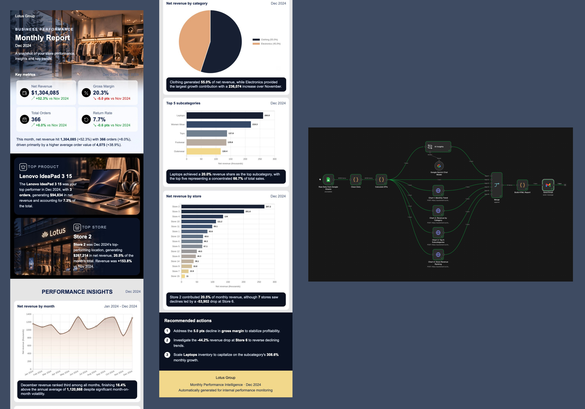

# Automated Retail Performance Reporting with n8n and Generative AI

**An end-to-end pipeline that turns raw retail sales data into a designed monthly performance email, with no manual work.**



*Left and centre: the email the pipeline sends. Right: the n8n workflow behind it.*

## The problem

Monthly performance reporting is repetitive. Someone exports data, cleans it, rebuilds the same KPIs and charts, and writes the commentary, and it is easy to get wrong. I built a workflow that does all of it automatically and delivers a report a manager can read in under a minute.

## What it delivers

- **4 KPI cards** (net revenue, gross margin, total orders, return rate), each with its change against the previous month
- **Top product and top store** of the month
- **4 charts**, each with a one-line takeaway: revenue trend, revenue by category, top 5 subcategories, revenue by store
- **3 recommended actions** based on what moved


## How it works

Google Sheets → data cleaning (Python) → KPI calculation (Python) → four charts (QuickChart) and written insights (Gemini) → HTML report (Python) → Gmail

The whole thing is nine nodes in n8n. The cleaning, KPI and report steps are Python scripts written without imports, because n8n's sandbox does not allow them, so dates, number formatting and text parsing are all hand-built.

```
Google Sheets (raw data)
      |
Code (Python): Clean Data
      |
Code (Python): Calculate KPIs  ----> facts for the LLM + 4 chart configs
      |                                   |
      |            +----------------------+----------------------+
      |            |                      |                      |
      |      HTTP: QuickChart x4     Gemini LLM chain       (KPI row)
      |      (monthly, category,     (tagged insights)           |
      |       subcategory, store)           |                    |
      |            |                        |                    |
      +------------+------------ Merge (6 inputs) ---------------+
                                   |
                        Code (Python): Build HTML report
                                   |
                                 Send Gmail
```

## Key decisions

**The AI never does the maths.** The KPI script calculates every figure first and hands the model short fact lists. The model only writes one sentence per section, in a fixed tagged format that the report script parses. The insights can't contain invented numbers, and a missing section doesn't break the email.

**Revenue is attributed to the right products.** Orders can contain several products. My first version credited a whole order to its first product, which distorted the category chart and best-product card. I caught it, rebuilt the data at order-line level, and checked that line revenue reconciles to order revenue and that category and product figures match an independent pandas calculation.

**Metrics are defined carefully.** Net revenue counts Completed orders only. Return rate is Returned orders over all orders. Margin and return rate changes are shown in percentage points, not percent. The report compares the latest month in the data with the one before it, and flags a partial month.

**The email is built for real inboxes.** Table-based HTML with inline CSS, a mobile layout, fallbacks for gradients and transparency, and a size far below Gmail's clipping limit. Charts are images from QuickChart because email can't run JavaScript.

## Data cleaning

Duplicate lines, mixed date formats (ISO, DD/MM/YYYY, timestamps, Excel serials), amounts stored as text, stray spaces, inconsistent order-status spelling and missing employee or product fields were all handled before any KPI was calculated.

## Skills demonstrated

Workflow automation (n8n) · Python for data cleaning and KPI logic · Google Sheets · KPI and metric design · Data validation and reconciliation · Data visualisation · LLM prompt design and output parsing · HTML email development

## Data and limitations

Dataset: [Lotus Group Retail Star Schema BI](https://www.kaggle.com/datasets/abdelrahmanmahmoud22/lotus-group-retail-star-schema-bi) (Kaggle). It is a fictional retailer with one year of orders in $, so the numbers are for demonstration. Month-over-month changes are not adjusted for seasonality.

## Code

Scripts are in [`scripts/`](scripts/), the LLM prompt is in [`prompts/`](prompts/), and the workflow export is in [`workflow/`](workflow/).
