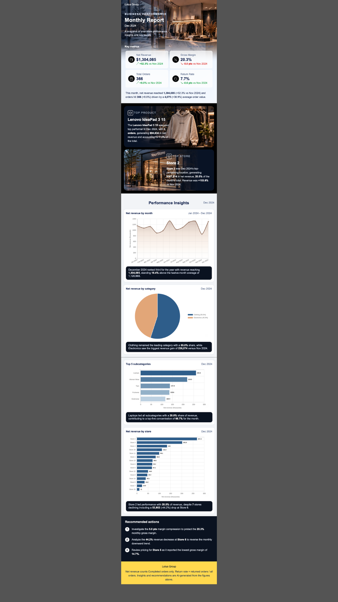

# Automated Monthly Retail Performance Report (n8n + Google Sheets + Gemini)

An n8n workflow that reads a retail sales table from Google Sheets, cleans it, calculates month-over-month KPIs, draws four charts, asks an LLM to write short insights, and emails a designed HTML report. It runs with no manual steps.


<!-- TODO: replace with a screenshot of the final email -->

## What the email contains

- **4 KPI cards**: net revenue, gross margin, total orders, return rate. Each shows the change against the previous month.
- **A short headline insight** explaining what moved and why it matters.
- **4 charts, each with a one-line insight**: monthly net revenue trend, revenue by category (pie), top 5 subcategories, revenue by store.
- **2 feature cards**: best-selling product and best-performing store.
- **Recommended actions**: 3 to 4 concrete next steps.

The report compares the latest month in the data with the month before it. If the latest month has fewer days than the previous one, the report says it is a partial month.

## Architecture

```
Schedule Trigger
      |
Google Sheets (orders_2024, one row per order line)
      |
Code (Python): Data cleaning
      |
Code (Python): KPI generation  ----> facts for the LLM + 4 chart configs
      |                                   |
      |            +----------------------+----------------------+
      |            |                      |                      |
      |      HTTP: QuickChart x4     Gemini LLM chain       (KPI row)
      |      (monthly, category,     (tagged insights)           |
      |       subcategory, store)           |                    |
      |            |                        |                    |
      +------------+------------ Merge (6 inputs) ---------------+
                                   |
                        Code (Python): HTML report
                                   |
                                 Gmail
```

| Step | File | What it does |
|---|---|---|
| Cleaning | `scripts/n8n_clean_orders.py` | Fixes types, dates and text, removes duplicate lines, adds net revenue/cost/profit columns |
| KPIs | `scripts/n8n_kpis_orders.py` | Computes month-over-month KPIs, builds chart configs and pre-computed facts for the LLM |
| Insights | `prompts/` | Prompt that turns the facts into one-sentence tagged insights |
| Report | `scripts/n8n_report_orders_html.py` | Parses the insights and builds the email-safe HTML |

n8n's Python Code node does not allow imports, so every script is plain Python with hand-written date handling, number formatting and parsing.

## Dataset

[Lotus Group Retail Star Schema BI](https://www.kaggle.com/datasets/abdelrahmanmahmoud22/lotus-group-retail-star-schema-bi) on Kaggle. It is a fictional retailer with orders in EGP, 2024. Check the dataset's licence on Kaggle before reusing it. `data/sample_orders_lines.csv` is a small sample for trying the scripts.

The workflow reads one Google Sheets table with one row per order line. It is built from three source tables:

| Source | Used for |
|---|---|
| `orders_2024` | order date, store, employee, payment method, status |
| `orders_detail` | one row per product line: quantity, line revenue, line cost |
| `products` | product name, category, subcategory, brand |

Each line is joined to its order and product with `ARRAYFORMULA` + `VLOOKUP` (see [docs/build-the-table.md](docs/build-the-table.md)). Looking up from a line to its order or product is always safe, because each line has exactly one of each.

### Why the table is at line level

Orders can contain several products. My first version used one product column per order, which credited an order's whole revenue to its first product and made the category chart and best-product card wrong. Moving to one row per line fixed it. After the fix:

- line revenue adds up to order revenue (0.0% difference for the latest month)
- category, subcategory and best-product numbers match an independent pandas calculation

Order-level KPIs (orders, return rate, store revenue) are rebuilt by grouping the lines by `order_id`, so each order is still counted once.

## Data cleaning

| Problem | Handling |
|---|---|
| Duplicate rows | Keep the first row per `detail_id` |
| Mixed date formats (ISO, DD/MM/YYYY, timestamps, Excel serials) | Parsed to `YYYY-MM-DD`; rows with no usable date are dropped |
| Amounts stored as text or with symbols | Converted to numbers; unusable rows dropped |
| Extra spaces in text (e.g. payment method) | Trimmed |
| Order status spelling (`complete`, `canceled`, ...) | Mapped to Completed / Returned / Cancelled |
| Missing employee | Kept as `UNASSIGNED` so revenue still counts |
| Missing product fields | Set to `Unknown` |

## KPI definitions

| KPI | Definition |
|---|---|
| Net revenue | Revenue of **Completed** orders only |
| Gross margin | Net profit / net revenue (Completed orders) |
| Total orders | Distinct orders in the month, all statuses |
| Return rate | Returned orders / all orders in the month |
| Month-over-month | Latest month in the data vs the one before it (percentage change; margin and return rate are shown in percentage points) |

Latest month in the sample run (December 2024): net revenue 1,304,085 EGP (+52.3%), gross margin 20.3% (-5.0 pts), 366 orders (+8.0%), return rate 7.7% (-0.6 pts). The top subcategory is Gaming and the best product is the Sony PS5 Console.

## How the LLM insights stay accurate

The model never calculates anything. The KPI script pre-computes every figure and writes it into short fact lists. The prompt asks for one sentence per section in a fixed tagged format:

```
[KPI] ...  [TREND] ...  [CATEGORY] ...  [SUBCATEGORY] ...  [STORE] ...  [ACTIONS] ...
```

Key figures are wrapped in `**bold**`. The report script parses the tags and turns bold into `<strong>`. If a section is missing, the report leaves that strip out instead of failing.

## Design decisions

- **Four separate chart requests, then Merge**: easy to debug and swap a single chart.
- **QuickChart for charts**: returns an image URL, which works in every email client (no JavaScript in email).
- **Table-based HTML with inline CSS**: email clients ignore most modern CSS. The report has a mobile layout and plain fallbacks for gradients and transparency, and stays well under Gmail's clipping limit (about 22 KB vs 102 KB).
- **Latest month in the data, not today's date**, so the report works on historical data.
- **Order-level and line-level in one table**: one Sheets node and a simple workflow.

## How to run it

1. Build the line-level table in Google Sheets ([docs/build-the-table.md](docs/build-the-table.md)) or load the sample CSV.
2. In n8n, import `workflow/workflow.json` (remove or replace credentials first).
3. Set up credentials: Google Sheets, Gmail, and a Gemini API key (a free Google AI Studio key works).
4. On the Google Sheets node, turn **Execute Once** on, otherwise the node runs once per row.
5. Paste the three scripts into the Code nodes and the prompt into the LLM chain.
6. In the report script, set `BRAND_NAME`, `HERO_IMAGE_URL`, `PRODUCT_IMAGE_URL` and `STORE_IMAGE_URL`. Leave an image blank to use the built-in fallback.
7. Set the Gmail recipient and the schedule, and run it once manually to test.

## Limitations

- The data is fictional and covers one year, so the numbers are for demonstration.
- Month-over-month compares a month with its predecessor and does not adjust for seasonality.
- If the latest month is partial, the report says so, but the comparison is still against a full month.
- The best-product card picks one product by revenue, which is not the same as by profit.
- Charts depend on the QuickChart service being available.

## Repository layout

```
.
├── README.md
├── LICENSE
├── workflow/        n8n workflow export (secrets removed)
├── scripts/         the three Python Code-node scripts
├── prompts/         LLM prompt
├── data/            small sample CSV
├── docs/            email screenshot, how to build the table
└── preview/         static HTML preview of the report
```

## Author

Xanh - [GitHub](https://github.com/YOUR-USERNAME) - [LinkedIn](https://linkedin.com/in/YOUR-PROFILE)
